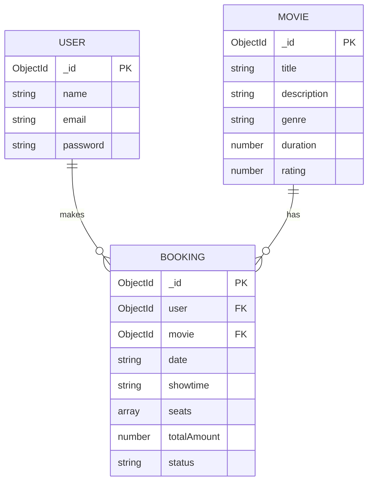

# IMovies – Entity-Relationship (ER) Diagram

## 1. Introduction

The ER diagram represents the database structure of the IMovies movie ticket booking system. It identifies the main entities, their attributes, primary keys, and relationships.

The principal entities are User, Movie, and Booking.

## 2. Entities and Attributes

### 2.1 User

Stores the details of registered users.

- **_id:** Unique identifier for each user (primary key).
- **name:** Name of the user.
- **email:** Email address used for authentication.
- **password:** Hashed password.
- **createdAt / updatedAt:** Record creation and modification timestamps, when enabled in the schema.

### 2.2 Movie

Stores information about movies available for booking.

- **_id:** Unique identifier for each movie (primary key).
- **title:** Movie title.
- **description:** Movie synopsis.
- **genre:** Movie category.
- **duration:** Movie duration.
- **rating:** Movie rating.
- **poster:** Movie poster image reference.
- **language:** Movie language.
- **showtimes:** Configured showtime information.

The exact attributes depend on the Movie schema implemented in the source code.

### 2.3 Booking

Stores the details of a user's movie ticket booking.

- **_id:** Unique identifier for each booking (primary key).
- **user:** Reference to the user who made the booking.
- **movie:** Reference to the selected movie.
- **date:** Booking date or selected show date.
- **showtime:** Selected showtime.
- **seats:** Selected seat identifiers.
- **totalAmount:** Total booking price.
- **status:** Booking status, where supported by the implementation.
- **createdAt / updatedAt:** Booking timestamps, when enabled in the schema.

## 3. ER Diagram

## 4. Relationships

### 4.1 User–Booking Relationship

One user can make multiple bookings. Each booking belongs to the user who created it. This represents a one-to-many relationship.

### 4.2 Movie–Booking Relationship

One movie can be associated with multiple bookings. Each booking references the selected movie. This also represents a one-to-many relationship.

## 5. Database Integrity

- Each entity has a unique identifier.
- A booking references a user and a movie.
- Authentication and authorization should ensure that users can access only their own booking records.
- Backend validation should verify that requested movies and seats are valid.
- Database constraints and appropriate concurrency controls can help prevent duplicate seat reservations.

## 6. Conclusion

The ER diagram provides a conceptual overview of the IMovies database. It shows how user accounts, movie information, and booking records are connected to support the movie ticket booking workflow.
