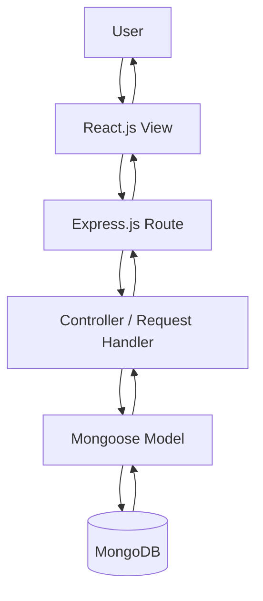

# IMovies – MVC Pattern

## 1. Introduction

MVC stands for Model–View–Controller. It is a software architectural pattern that separates an application's data, presentation, and request-handling responsibilities.

In IMovies, the frontend is developed using React.js, while the backend uses Node.js and Express.js. The backend can be explained using MVC concepts where models manage database records, routes direct requests, and controllers process application operations.

The exact separation depends on the implementation of the project source code.

## 2. Components of MVC

### 2.1 Model

The Model represents the application's data and its interaction with the database.

In IMovies, Mongoose models define the structure of MongoDB records, including users, movies, and bookings.

Responsibilities:
- Define data schemas.
- Represent database records.
- Support database queries and updates.
- Help maintain data consistency through validation and schema rules.

Examples:
- User model
- Movie model
- Booking model

### 2.2 View

The View represents the user interface presented to the user.

In IMovies, React.js components display the movie listings, movie details, login and registration forms, seat-selection interface, booking summaries, and booking history.

Responsibilities:
- Display information.
- Accept user input.
- Provide interactive controls.
- Show success messages and errors returned by the backend.

### 2.3 Controller

The Controller handles application requests and coordinates operations between the request-handling layer and the data layer.

In an Express.js application, controller functions may handle registration, login, movie retrieval, booking creation, booking cancellation, and booking history.

Responsibilities:
- Process incoming requests.
- Validate input.
- Apply application rules.
- Call models or database operations.
- Return appropriate HTTP responses.

## 3. MVC Workflow

## 4. Example: Creating a Booking

1. The user selects a movie, showtime, and seats in the React.js interface.
2. The frontend sends a booking request to the Express.js API.
3. The route directs the request to the appropriate request handler.
4. The handler validates the request and checks the relevant booking information.
5. The Mongoose model is used to create or retrieve database records.
6. MongoDB stores the booking if the operation succeeds.
7. The backend returns a response.
8. React.js displays the booking confirmation or an error message.

## 5. Benefits of MVC

- Separation of responsibilities.
- Easier maintenance and debugging.
- Better organization of backend code.
- Improved code reuse.
- Easier testing of individual components.
- Clearer separation between the interface and database operations.

## 6. Conclusion

MVC concepts help organize the responsibilities of the IMovies application. React.js provides the user interface, Express.js handles API routing and request processing, and Mongoose models interact with MongoDB. The exact MVC structure should be described according to the actual source-code organization.
