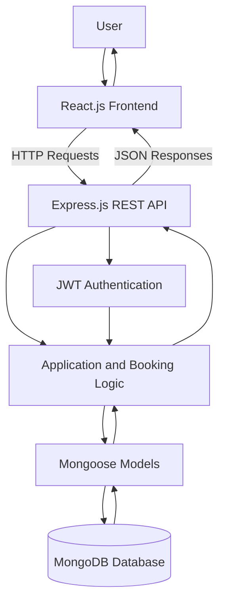

# IMovies – Technical Architecture

## 1. Introduction

IMovies is a full-stack web application developed to simplify online movie ticket booking. It allows users to browse movies, view movie details, select showtimes, choose seats, and manage their bookings through a user-friendly interface.

The application follows a client-server architecture, separating the frontend, backend, and database layers to improve maintainability and organization.

## 2. Technology Stack

- **Frontend:** React.js, HTML, CSS, JavaScript, Bootstrap
- **Backend:** Node.js and Express.js
- **Database:** MongoDB
- **ODM:** Mongoose
- **Authentication:** JSON Web Token (JWT)
- **Password Security:** bcrypt
- **Development Tools:** Visual Studio Code, npm, Google Chrome

## 3. Architecture Components

### 3.1 Presentation Layer

The presentation layer is implemented using React.js. It displays movie listings, movie details, authentication forms, seat selection, booking summaries, and booking history.

It receives user input and communicates with the backend through HTTP requests.

### 3.2 Application Layer

The application layer is implemented using Node.js and Express.js. It handles API requests, validates input, manages authentication, processes booking operations, and communicates with MongoDB.

### 3.3 Data Layer

MongoDB stores application data, including user accounts, movie information, and booking records. Mongoose provides schemas and models for interacting with the database.

## 4. Architecture Diagram

## 5. Working of the System

1. The user interacts with the React.js interface.
2. The frontend sends requests to the Express.js backend.
3. The backend validates requests and checks authentication when required.
4. Mongoose models communicate with MongoDB.
5. MongoDB stores or retrieves the required records.
6. The backend sends a response to the frontend.
7. The frontend displays the result to the user.

## 6. Advantages of the Architecture

- Separation of frontend, backend, and database responsibilities.
- Easier maintenance and debugging.
- Reusable React components.
- Organized API endpoints.
- Persistent data storage using MongoDB.
- Authentication support for protected operations.
- Ability to deploy the frontend and backend separately.

## 7. Conclusion

The IMovies architecture provides an organized foundation for a movie ticket booking application. By combining React.js, Express.js, Node.js, and MongoDB, the system separates user interaction, business logic, and data storage. This structure supports maintainability and future enhancements such as payment integration and administrative movie management.
