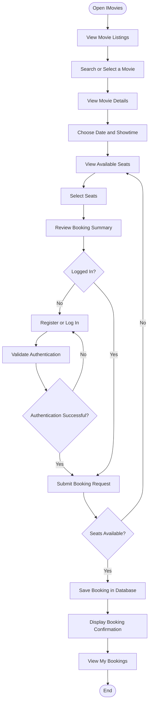
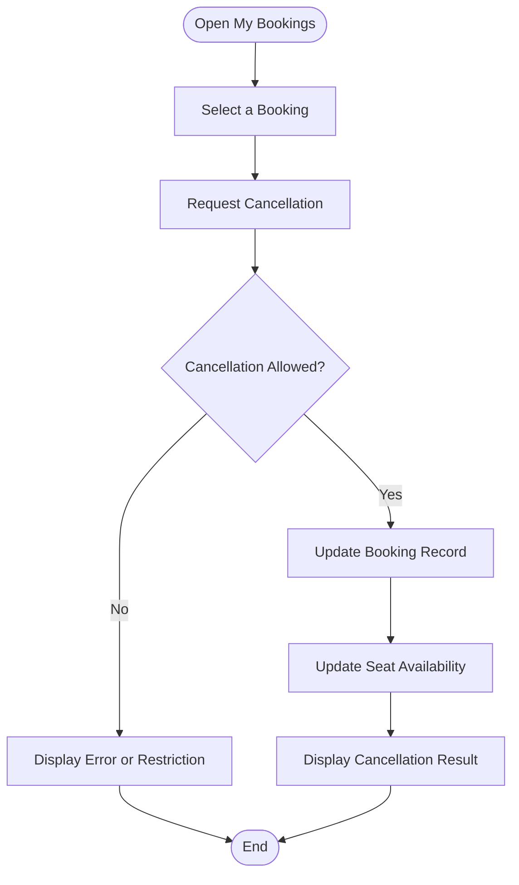

# IMovies – User Flow

## 1. Introduction

The user flow describes the sequence of actions a user performs while interacting with the IMovies movie ticket booking application. It covers movie discovery, authentication, seat selection, booking confirmation, and booking management.

## 2. Main User Flow

## 3. Explanation of the Flow

### Step 1: Open the Application

The user opens the IMovies website and views the homepage.

### Step 2: Browse Movies

The user explores available movies and searches for a preferred title or category where supported.

### Step 3: View Movie Details

The user opens a movie to view its information and configured showtimes.

### Step 4: Select a Date and Showtime

The user chooses the desired date and available showtime.

### Step 5: Select Seats

The application displays the seat layout. The user selects available seats and reviews the selection.

### Step 6: Review the Booking Summary

The application calculates the total amount using the selected seats and configured ticket price.

### Step 7: Authenticate the User

If authentication is required and the user is not logged in, the user registers or logs in before completing the booking.

### Step 8: Validate the Booking

The backend checks the booking request and verifies seat availability before creating the booking record.

### Step 9: Store the Booking

If the request is valid, the backend saves the booking in MongoDB.

### Step 10: Display Confirmation

The frontend displays the booking confirmation and relevant booking details.

### Step 11: Manage Bookings

The user can open My Bookings to review saved reservations and cancel eligible bookings.

## 4. Cancellation Flow

## 5. Conclusion

The user flow provides a clear representation of the main interaction paths in IMovies. It helps developers understand the order of operations and identify important validation points in the booking and cancellation processes.
